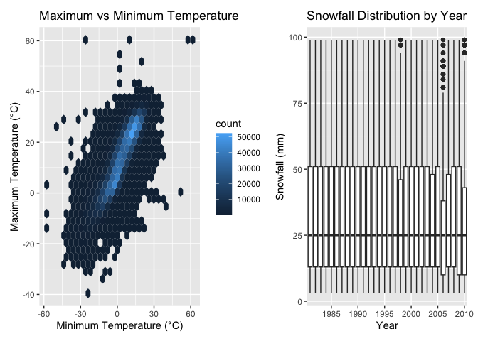
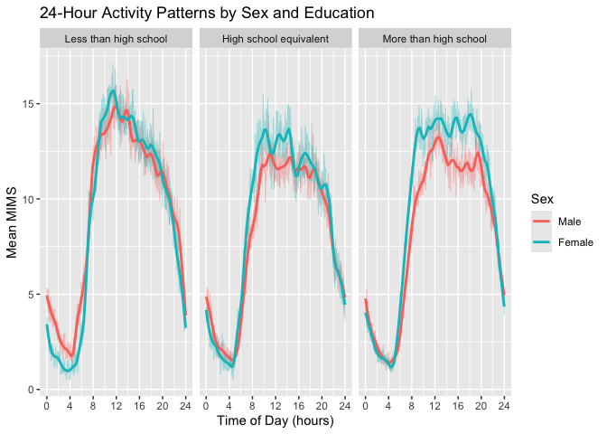
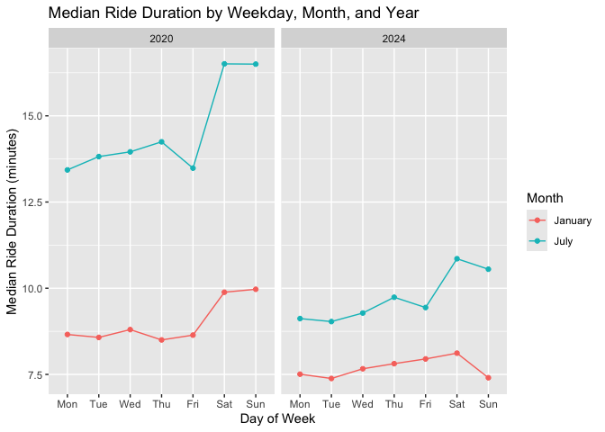

p8105_hw3_yp2846
================

# Problem 1

``` r
library(tidyverse)
```

    ## ── Attaching core tidyverse packages ──────────────────────── tidyverse 2.0.0 ──
    ## ✔ dplyr     1.2.1     ✔ readr     2.2.0
    ## ✔ forcats   1.0.1     ✔ stringr   1.6.0
    ## ✔ ggplot2   4.0.3     ✔ tibble    3.3.1
    ## ✔ lubridate 1.9.5     ✔ tidyr     1.3.2
    ## ✔ purrr     1.2.2     
    ## ── Conflicts ────────────────────────────────────────── tidyverse_conflicts() ──
    ## ✖ dplyr::filter() masks stats::filter()
    ## ✖ dplyr::lag()    masks stats::lag()
    ## ℹ Use the conflicted package (<http://conflicted.r-lib.org/>) to force all conflicts to become errors

``` r
library(lubridate)
library(patchwork)
```

``` r
library(p8105.datasets)
data("ny_noaa")
```

The dataset contains 2595176 rows and 7 columns. Each row represents a
daily weather observation at a weather station.

The key variables are id, date, prcp, snow, snwd, tmax, tmin. The `id`
and `date` variables identify the weather station and observation date,
while the remaining variables contain weather measurements.

``` r
colMeans(is.na(ny_noaa))*100
```

    ##       id     date     prcp     snow     snwd     tmax     tmin 
    ##  0.00000  0.00000  5.61958 14.68960 22.80331 43.71025 43.71264

Missing data are a substantial issue in this dataset, particularly for
temperature measurements. Both `tmax` and `tmin` have approximately
43.71% missing values, followed by snwd (22.80%), snow(14.69%), and
prcp(5.62%). `id` and `date` don’t have any missing value.

``` r
ny_noaa_clean = ny_noaa |>
  mutate(
    year = year(date),
    month = month(date),
    day = day(date),
    tmax = as.numeric(tmax)/10,
    tmin = as.numeric(tmin)/10,
    prcp = prcp/10
  )
```

``` r
ny_noaa_clean |>
  filter(!is.na(snow))|>
  count(snow, sort = TRUE) |>
  head(3)
```

    ## # A tibble: 3 × 2
    ##    snow       n
    ##   <int>   <int>
    ## 1     0 2008508
    ## 2    25   31022
    ## 3    13   23095

The most commonly observed snowfall values are 0 mm, 25 mm, and 13 mm.
The value 0 mm is by far the most frequent. This is expected because
most days of the year in New York State do not experience measurable
snowfall, especially during warmer months. The frequent values of 13 mm
and 25 mm may reflect snowfall measurements originally recorded in
inches and converted to millimeters, corresponding approximately to 0.5
and 1 inch, respectively.

``` r
ny_noaa_clean |>
  filter(month %in% c(1,7))|>
  group_by(id,year, month) |>
  summarize(mean_tmax = mean(tmax, na.rm = TRUE),
  .groups = "drop")|>
  ggplot(aes(x = year, y = mean_tmax)) +
  geom_point(alpha = 0.15, size = 0.6)+
  facet_grid(~month,
             labeller = labeller(
               month = c("1" = "January", "7" = "July")
  )) 
```

    ## Warning: Removed 5970 rows containing missing values or values outside the scale range
    ## (`geom_point()`).

<!-- -->

For New York state, July is generally warmer than January. The average
maximum temperature of January are mostly between $-5^\circ C$ and
$5^\circ C$. The average maximum temperature of July are mostly between
$24^\circ C$ and $30^\circ C$.

There is some year-to-year variation in both months, with a few
unusually low observations, particularly in July around 1988 and January
around 1982.

``` r
temp_plot = ny_noaa_clean |>
  drop_na(tmax,tmin)|>
  ggplot(aes(x = tmin, y = tmax)) +
  geom_hex()+
  labs(
    title = "Maximum vs Minimum Temperature",
    x = "Minimum Temperature (°C)",
    y = "Maximum Temperature (°C)"
  )

snow_plot = ny_noaa_clean |>
  filter(snow > 0, snow < 100) |>
  ggplot(aes(x = factor(year), y = snow)) +
  geom_boxplot() +
  labs(
    title = "Snowfall Distribution by Year",
    x = "Year",
    y = "Snowfall (mm)"
  )+
  scale_x_discrete(
    breaks = as.character(seq(1980, 2010, 5))
  )

temp_plot + snow_plot
```

<!-- -->

The left panel shows a strong positive association between minimum and
maximum temperatures, with most observations concentrated along an
upward-sloping band.

``` r
ny_noaa_clean |>
  filter(tmax < tmin) |>
  count()
```

    ## # A tibble: 1 × 1
    ##       n
    ##   <int>
    ## 1  1183

Some potential outliers are present, including extremely high or low
temperatures. Additionally, 1,183 observations have maximum temperatures
lower than minimum temperatures, suggesting possible data quality
issues.

The right panel shows the distribution of positive daily snowfall
observations below 100 mm across years. Days with no recorded snowfall
and observations of 100 mm or more were excluded. The median snowfall is
approximately 25 mm in most years, with the interquartile range
generally extending from 13 mm to 51 mm. Although some variation is
observed across years, there is no clear long-term trend within this
selected range. These findings apply only to the filtered observations
and do not represent the overall snowfall distribution, including days
without snowfall or extreme snowfall events.

# Problem 2

``` r
nhanes_covar = read_csv(
  "./data/nhanes_covar.csv",
  skip = 4,
  show_col_types = FALSE
)|>
  janitor::clean_names()

nhanes_accel = read_csv(
  "./data/nhanes_accel.csv",
  show_col_types = FALSE
)|>
  janitor::clean_names()

head(nhanes_covar,5)
```

    ## # A tibble: 5 × 5
    ##    seqn   sex   age   bmi education
    ##   <dbl> <dbl> <dbl> <dbl>     <dbl>
    ## 1 62161     1    22  23.3         2
    ## 2 62164     2    44  23.2         3
    ## 3 62169     1    21  20.1         2
    ## 4 62174     1    80  33.9         3
    ## 5 62177     1    51  20.1         2

``` r
head(nhanes_accel,5)
```

    ## # A tibble: 5 × 1,441
    ##    seqn  min1  min2  min3  min4  min5  min6  min7  min8   min9 min10 min11
    ##   <dbl> <dbl> <dbl> <dbl> <dbl> <dbl> <dbl> <dbl> <dbl>  <dbl> <dbl> <dbl>
    ## 1 62161  1.11  3.12  1.47 0.938  1.60 0.145 2.10  0.509  1.63   1.20 0.947
    ## 2 62164  1.92  1.67  2.38 0.935  2.59 5.22  2.39  4.90   1.97   3.13 2.77 
    ## 3 62169  5.85  5.18  4.76 6.48   6.85 7.24  6.12  7.48   5.47   6.49 5.14 
    ## 4 62174  5.42  3.48  3.72 3.81   6.85 4.45  0.561 1.61   0.698  2.72 4.85 
    ## 5 62177  6.14  8.06  9.99 6.60   4.57 2.78  7.10  7.25  10.1    7.49 2.72 
    ## # ℹ 1,429 more variables: min12 <dbl>, min13 <dbl>, min14 <dbl>, min15 <dbl>,
    ## #   min16 <dbl>, min17 <dbl>, min18 <dbl>, min19 <dbl>, min20 <dbl>,
    ## #   min21 <dbl>, min22 <dbl>, min23 <dbl>, min24 <dbl>, min25 <dbl>,
    ## #   min26 <dbl>, min27 <dbl>, min28 <dbl>, min29 <dbl>, min30 <dbl>,
    ## #   min31 <dbl>, min32 <dbl>, min33 <dbl>, min34 <dbl>, min35 <dbl>,
    ## #   min36 <dbl>, min37 <dbl>, min38 <dbl>, min39 <dbl>, min40 <dbl>,
    ## #   min41 <dbl>, min42 <dbl>, min43 <dbl>, min44 <dbl>, min45 <dbl>, …

``` r
nhanes_covar = nhanes_covar |>
  filter(
    age >= 21,
    !is.na(sex),
    !is.na(age),
    !is.na(bmi),
    !is.na(education)
  ) |>
  mutate(
    sex = factor(
      sex,
      levels = c(1, 2),
      labels = c("Male", "Female")
    ),
    education = factor(
      education,
      levels = c(1, 2, 3),
      labels = c(
        "Less than high school",
        "High school equivalent",
        "More than high school"
      )
    )
  )
nhanes = nhanes_covar |>
  inner_join(nhanes_accel, by = "seqn")
head(nhanes,5)
```

    ## # A tibble: 5 × 1,445
    ##    seqn sex      age   bmi education    min1  min2  min3  min4  min5  min6  min7
    ##   <dbl> <fct>  <dbl> <dbl> <fct>       <dbl> <dbl> <dbl> <dbl> <dbl> <dbl> <dbl>
    ## 1 62161 Male      22  23.3 High schoo…  1.11  3.12  1.47 0.938  1.60 0.145 2.10 
    ## 2 62164 Female    44  23.2 More than …  1.92  1.67  2.38 0.935  2.59 5.22  2.39 
    ## 3 62169 Male      21  20.1 High schoo…  5.85  5.18  4.76 6.48   6.85 7.24  6.12 
    ## 4 62174 Male      80  33.9 More than …  5.42  3.48  3.72 3.81   6.85 4.45  0.561
    ## 5 62177 Male      51  20.1 High schoo…  6.14  8.06  9.99 6.60   4.57 2.78  7.10 
    ## # ℹ 1,433 more variables: min8 <dbl>, min9 <dbl>, min10 <dbl>, min11 <dbl>,
    ## #   min12 <dbl>, min13 <dbl>, min14 <dbl>, min15 <dbl>, min16 <dbl>,
    ## #   min17 <dbl>, min18 <dbl>, min19 <dbl>, min20 <dbl>, min21 <dbl>,
    ## #   min22 <dbl>, min23 <dbl>, min24 <dbl>, min25 <dbl>, min26 <dbl>,
    ## #   min27 <dbl>, min28 <dbl>, min29 <dbl>, min30 <dbl>, min31 <dbl>,
    ## #   min32 <dbl>, min33 <dbl>, min34 <dbl>, min35 <dbl>, min36 <dbl>,
    ## #   min37 <dbl>, min38 <dbl>, min39 <dbl>, min40 <dbl>, min41 <dbl>, …

``` r
demo_table = nhanes |>
  count(education, sex)

demo_table
```

    ## # A tibble: 6 × 3
    ##   education              sex        n
    ##   <fct>                  <fct>  <int>
    ## 1 Less than high school  Male      27
    ## 2 Less than high school  Female    28
    ## 3 High school equivalent Male      35
    ## 4 High school equivalent Female    23
    ## 5 More than high school  Male      56
    ## 6 More than high school  Female    59

``` r
demo_table = nhanes |>
  count(education, sex) |>
  pivot_wider(
    names_from = sex,
    values_from = n,
    values_fill = 0
  ) |>
  mutate(Total = Male + Female)

knitr::kable(
  demo_table,
  caption = "Number of Participants by Education Level and Sex"
)
```

| education              | Male | Female | Total |
|:-----------------------|-----:|-------:|------:|
| Less than high school  |   27 |     28 |    55 |
| High school equivalent |   35 |     23 |    58 |
| More than high school  |   56 |     59 |   115 |

Number of Participants by Education Level and Sex

``` r
nhanes |>
  ggplot(aes(x = sex, y = age, fill = sex)) +
  geom_boxplot(alpha = 0.6, outlier.shape = NA) +
  geom_jitter(
    width = 0.15,
    alpha = 0.4,
    size = 1
  ) +
  facet_wrap(~ education) +
  labs(
    title = "Age Distribution by Sex and Education Level",
    x = "Sex",
    y = "Age (years)",
    fill = "Sex"
  ) +
  theme(
    legend.position = "none"
  )
```

<!-- -->

The sample includes 228 participants, with 118 men and 110 women. The
more-than-high-school education group is the largest, with 115
participants, while the other two groups have similar sample sizes.

Age distributions differ across education levels. Participants with more
than a high school education tend to be younger, while those with less
than a high school education tend to be older. Within the high school
equivalent group, women have a higher median age than men. In contrast,
the age distributions of men and women are relatively similar in the
other two education groups.

``` r
nhanes_total = nhanes |>
  mutate(
    total_activity = rowSums(
      pick(starts_with("min")),
      na.rm = TRUE
    )
  )

nhanes_total |>
  ggplot(aes(x = age, y = total_activity, color = sex)) +
  geom_point(alpha = 0.5) +
  geom_smooth(method = "loess", se = FALSE) +
  facet_wrap(~ education) +
  labs(
    title = "Total Daily Activity by Age, Sex, and Education",
    x = "Age (years)",
    y = "Total Daily MIMS",
    color = "Sex"
  )
```

    ## `geom_smooth()` using formula = 'y ~ x'

<!-- -->

``` r
nhanes |>
  mutate(
    n_missing = rowSums(
      is.na(pick(starts_with("min")))
    )
  ) |>
  summarise(
    participants_with_missing = sum(n_missing > 0),
    max_missing_minutes = max(n_missing)
  )
```

    ## # A tibble: 1 × 2
    ##   participants_with_missing max_missing_minutes
    ##                       <int>               <dbl>
    ## 1                         0                   0

Total daily activity generally decreases with age across all three
education levels, although the patterns are not strictly linear. The
decline is particularly noticeable among participants with less than a
high school education. Women tend to have higher total activity than men
in the high school equivalent and more than high school groups,
especially at younger and middle ages. However, there is considerable
variability within each group, and the smoothed trends should be
interpreted cautiously.

Total daily activity was calculated by summing the 1440 minute-level
MIMS values for each participant. All 228 participants had complete
minute-level activity measurements, so no observations were excluded due
to missing MIMS values.

``` r
nhanes_long = nhanes |>
  pivot_longer(
    cols = starts_with("min"),
    names_to = "minute",
    values_to = "MIMS"
  ) |>
  mutate(
    minute = as.numeric(str_remove(minute, "min"))
  )

activity_by_minute = nhanes_long |>
  group_by(education, sex, minute) |>
  summarise(
    mean_MIMS = mean(MIMS, na.rm = TRUE),
    .groups = "drop"
  )
```

``` r
activity_by_minute |>
  ggplot(aes(x = (minute-1) / 60, y = mean_MIMS, color = sex)) +
  geom_line(alpha = 0.35, linewidth = 0.4) +
  geom_smooth(method = "loess", se = FALSE, span = 0.1) +
  facet_wrap(~ education) +
  scale_x_continuous(
    breaks = seq(0, 24, 4)
  ) +
  labs(
    title = "24-Hour Activity Patterns by Sex and Education",
    x = "Time of Day (hours)",
    y = "Mean MIMS",
    color = "Sex"
  )
```

    ## `geom_smooth()` using formula = 'y ~ x'

<!-- -->

Across all three education levels, activity follows a similar daily
pattern, reaching its lowest levels during the early morning hours
(approximately 3–5 AM), increasing rapidly after 5 AM, and declining
again in the evening.

Sex differences vary by education level. Men and women with less than a
high school education show relatively similar activity patterns, while
women tend to have higher daytime activity levels in the other two
education groups. Participants with less than a high school education
show a more pronounced late-morning peak, whereas those with more than a
high school education maintain relatively stable activity levels during
the daytime hours.

Overall, the results suggest that daily activity patterns differ by sex
and education level, although these descriptive differences do not
necessarily imply statistically significant associations.

# Problem 3

``` r
jan_2020 = read_csv(
  "./data/citibike/Jan 2020 Citi.csv",
  show_col_types = FALSE
) |>
  mutate(year = 2020, month = "January")

july_2020 = read_csv(
  "./data/citibike/July 2020 Citi.csv",
  show_col_types = FALSE
) |>
  mutate(year = 2020, month = "July")

jan_2024 = read_csv(
  "./data/citibike/Jan 2024 Citi.csv",
  show_col_types = FALSE
) |>
  mutate(year = 2024, month = "January")

july_2024 = read_csv(
  "./data/citibike/July 2024 Citi.csv",
  show_col_types = FALSE
) |>
  mutate(year = 2024, month = "July")
```

``` r
citibike = bind_rows(
  jan_2020,
  july_2020,
  jan_2024,
  july_2024
)

citibike = citibike |>
  mutate(
    year = factor(year),
    month = factor(
      month,
      levels = c("January", "July")
    ),
    weekdays = factor(
      weekdays,
      levels = c(
        "Monday", "Tuesday", "Wednesday",
        "Thursday", "Friday", "Saturday", "Sunday"
      )
    ),
    member_casual = factor(
      member_casual,
      levels = c("casual", "member"),
      labels = c("Casual", "Member")
    ),
    rideable_type = factor(
      rideable_type,
      levels = c("classic_bike", "electric_bike"),
      labels = c("Classic bike", "Electric bike")
    )
  )
```

The combined dataset contains 99485 sampled Citi Bike rides from January
and July of 2020 and 2024, with 9 variables describing ride
characteristics, duration, station information, membership status, year,
and month. Each ride has a unique identifier, and ride duration ranges
from approximately 1.0016 to 238.7798 minutes, with a median of 9.8394
minutes. Most rides were taken by members. There are 43 missing starting
station names and 207 missing ending station names, which are retained
for analyses that do not require station information.

``` r
ride_count_table = citibike |>
  count(year, month, member_casual) |>
  pivot_wider(
    names_from = member_casual,
    values_from = n,
    values_fill = 0
  ) |>
  mutate(Total = Casual + Member)

knitr::kable(
  ride_count_table,
  caption = "Number of Rides by Year, Month, and Membership"
)
```

| year | month   | Casual | Member | Total |
|:-----|:--------|-------:|-------:|------:|
| 2020 | January |    984 |  11436 | 12420 |
| 2020 | July    |   5637 |  15411 | 21048 |
| 2024 | January |   2108 |  16753 | 18861 |
| 2024 | July    |  10894 |  36262 | 47156 |

Number of Rides by Year, Month, and Membership

Members accounted for the majority of sampled rides in all four
year-month combinations. July had more rides than January in both 2020
and 2024, suggesting a seasonal pattern in bike usage. The number of
sampled rides was also higher in 2024 than in 2020 for both months, with
July 2024 having the highest count (47,156 rides). Casual ridership
increased substantially from January to July in both years, suggesting
that casual riders may be more sensitive to seasonal changes than
members.

``` r
top5_stations = citibike |>
  filter(
    year == "2024",
    month == "July",
    !is.na(start_station_name)
  ) |>
  count(start_station_name, sort = TRUE) |>
  slice_head(n = 5) |>
  rename(
    `Starting Station` = start_station_name,
    `Number of Rides` = n
  )

knitr::kable(
  top5_stations
)
```

| Starting Station         | Number of Rides |
|:-------------------------|----------------:|
| Pier 61 at Chelsea Piers |             163 |
| University Pl & E 14 St  |             155 |
| W 21 St & 6 Ave          |             152 |
| West St & Chambers St    |             150 |
| W 31 St & 7 Ave          |             146 |

The table shows the five most frequently used starting stations in the
July 2024 sample, ranked by the number of rides originating from each
station. These stations represent the most popular departure locations
among the sampled rides during this period.

``` r
duration_summary = citibike |>
  group_by(year, month, weekdays) |>
  summarise(
    median_duration = median(duration, na.rm = TRUE),
    .groups = "drop"
  )

duration_summary |>
  ggplot(
    aes(
      x = weekdays,
      y = median_duration,
      color = month,
      group = month
    )
  ) +
  geom_line() +
  geom_point() +
  facet_wrap(~ year) +
  labs(
    title = "Median Ride Duration by Weekday, Month, and Year",
    x = "Day of Week",
    y = "Median Ride Duration (minutes)",
    color = "Month"
  )+
  scale_x_discrete(
    labels = c("Mon", "Tue", "Wed", "Thu", "Fri", "Sat", "Sun")
  )
```

<!-- -->

Median ride duration was consistently longer in July than in January
across both years. Weekend rides generally lasted longer than weekday
rides, particularly in July 2020, when median durations peaked at
approximately 16.5 minutes. This weekend pattern was less pronounced in
2024.

Additionally, median ride durations were lower in 2024 than in 2020
across both months and most days of the week. Overall, the plot suggests
that ride duration varies by month, day of the week, and year, with
particularly noticeable differences between January and July.

``` r
citibike_2024 = citibike |>
  filter(year == "2024")

citibike_2024 |>
  ggplot(
    aes(
      x = member_casual,
      y = duration,
      fill = rideable_type
    )
  ) +
  geom_boxplot(
    position = position_dodge(),
    outlier.shape = NA
  ) +
  facet_wrap(~ month) +
  coord_cartesian(ylim = c(0, 60)) +
  labs(
    title = "Ride Duration by Month, Membership, and Bike Type (2024)",
    x = "Membership Status",
    y = "Ride Duration (minutes)",
    fill = "Bike Type"
  )
```

<!-- -->

In 2024, casual riders generally had longer median ride durations and
greater variability than members, particularly when using classic bikes.
Ride durations also tended to be longer in July than in January across
most groups. Among casual riders, classic bikes had higher median
durations than electric bikes in both months. However, among members,
the differences between bike types were smaller, with electric bikes
showing a slightly higher median duration in July. Overall, the results
suggest that ride duration varies by month, membership status, and bike
type, with possible differences in the relationship between bike type
and duration across membership groups.
