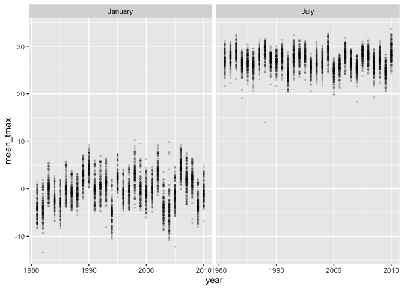

p8105_hw3_yp2846
================

# Problem 1

``` r
library(tidyverse)
```

    ## ── Attaching core tidyverse packages ──────────────────────── tidyverse 2.0.0 ──
    ## ✔ dplyr     1.2.1     ✔ readr     2.2.0
    ## ✔ forcats   1.0.1     ✔ stringr   1.6.0
    ## ✔ ggplot2   4.0.3     ✔ tibble    3.3.1
    ## ✔ lubridate 1.9.5     ✔ tidyr     1.3.2
    ## ✔ purrr     1.2.2     
    ## ── Conflicts ────────────────────────────────────────── tidyverse_conflicts() ──
    ## ✖ dplyr::filter() masks stats::filter()
    ## ✖ dplyr::lag()    masks stats::lag()
    ## ℹ Use the conflicted package (<http://conflicted.r-lib.org/>) to force all conflicts to become errors

``` r
library(lubridate)
library(patchwork)
library(p8105.datasets)
data("ny_noaa")
```

The dataset contains 2595176 rows and 7 columns. Each row represents a
daily weather observation at a weather station. The key variables are
id, date, prcp, snow, snwd, tmax, tmin. The `id` and `date` variables
identify the weather station and observation date, while the remaining
variables contain weather measurements.

``` r
colMeans(is.na(ny_noaa))*100
```

    ##       id     date     prcp     snow     snwd     tmax     tmin 
    ##  0.00000  0.00000  5.61958 14.68960 22.80331 43.71025 43.71264

Missing data are a substantial issue in this dataset, particularly for
temperature measurements. Both `tmax` and `tmin` have approximately
43.71% missing values, followed by snwd (22.80%), snow(14.69%), and
prcp(5.62%). `id` and `date` don’t have any missing value.

``` r
ny_noaa_clean = ny_noaa |>
  mutate(
    year = year(date),
    month = month(date),
    day = day(date),
    tmax = as.numeric(tmax)/10,
    tmin = as.numeric(tmin)/10,
    prcp = prcp/10
  )
```

``` r
ny_noaa_clean |>
  filter(!is.na(snow))|>
  count(snow, sort = TRUE) |>
  head(3)
```

    ## # A tibble: 3 × 2
    ##    snow       n
    ##   <int>   <int>
    ## 1     0 2008508
    ## 2    25   31022
    ## 3    13   23095

The most commonly observed snowfall values are 0 mm, 25 mm, and 13 mm.
The value 0 mm is by far the most frequent. This is expected because
most days of the year in New York State do not experience measurable
snowfall, especially during warmer months. The frequent values of 13 mm
and 25 mm may reflect snowfall measurements originally recorded in
inches and converted to millimeters, corresponding approximately to 0.5
and 1 inch, respectively.

``` r
ny_noaa_clean |>
  filter(month %in% c(1,7))|>
  group_by(id,year, month) |>
  summarize(mean_tmax = mean(tmax, na.rm = TRUE),
  .groups = "drop")|>
  ggplot(aes(x = year, y = mean_tmax)) +
  geom_point(alpha = 0.15, size = 0.6)+
  facet_grid(~month,
             labeller = labeller(
               month = c("1" = "January", "7" = "July")
  )) 
```

    ## Warning: Removed 5970 rows containing missing values or values outside the scale range
    ## (`geom_point()`).

<!-- -->

For New York state, July is generally warmer than January. The average
maximum temperature of January are mostly between $-5^\circ C$ and
$5^\circ C$. The average maximum temperature of July are mostly between
$24^\circ C$ and $30^\circ C$.

There is some year-to-year variation in both months, with a few
unusually low observations, particularly in July around 1988 and January
around 1982.

``` r
temp_plot = ny_noaa_clean |>
  drop_na(tmax,tmin)|>
  ggplot(aes(x = tmin, y = tmax)) +
  geom_hex()+
  labs(
    title = "Maximum vs Minimum Temperature",
    x = "Minimum Temperature (°C)",
    y = "Maximum Temperature (°C)"
  )

snow_plot = ny_noaa_clean |>
  filter(snow > 0, snow < 100) |>
  ggplot(aes(x = factor(year), y = snow)) +
  geom_boxplot() +
  labs(
    title = "Snowfall Distribution by Year",
    x = "Year",
    y = "Snowfall (mm)"
  )+
  scale_x_discrete(
    breaks = as.character(seq(1980, 2010, 5))
  )

temp_plot + snow_plot
```

<!-- -->

The left panel shows a strong positive association between minimum and
maximum temperatures. Most observations are concentrated along an
upward-sloping band. This indicates that higher minimum temperatures are
generally associated with higher maximum temperatures. A few potential
outliers are present, including extremely high or low temperatures and
observations where the maximum temperature is lower than the minimum
temperature.

``` r
ny_noaa_clean |>
  filter(tmax < tmin) |>
  count()
```

    ## # A tibble: 1 × 1
    ##       n
    ##   <int>
    ## 1  1183

Some potential outliers are present, including extremely high or low
temperatures. Additionally, 1,183 observations have maximum temperatures
lower than minimum temperatures, suggesting possible data quality
issues.

The right panel shows that the distribution of snowfall between 0 and
100 mm is relatively consistent across years. The median snowfall is
approximately 25 mm in most years, with the interquartile range
generally extending from 13 mm to 51 mm. There are some variations in
later years, but no clear long-term trend is apparent.
